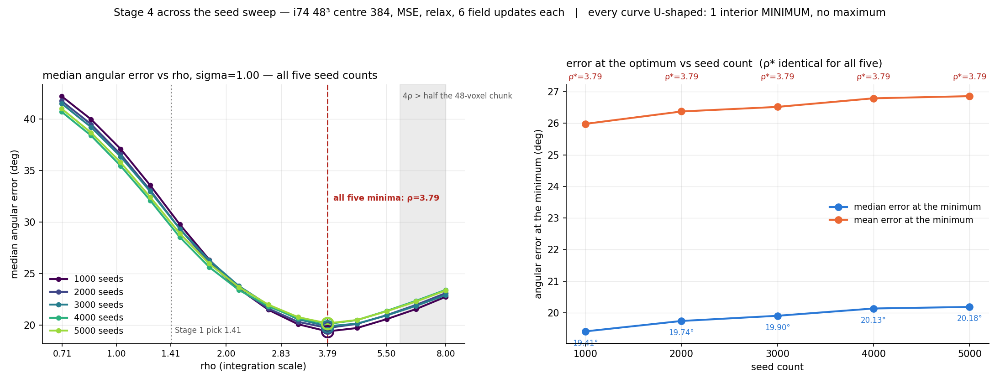

# Stage 4 — optimising (σ, ρ) against the refined field

Stage 3 ends with a **refined orientation field**: the Stage 2 field relaxed by
the optimised tractography cone. This stage asks what that refinement amounts
to:

> Is there a **plain** structure tensor, at one (σ, ρ), that gives the same
> directions?

If yes, the pipeline's effect can be summarised as a better scale choice, and
that pair can be used directly on new data. If no, the remaining angular gap is
what the tractography added beyond any single tensor. The number that decides
it is the angular error, in degrees, between the refined field and the plain
tensor's principal direction `e3`.

## Files

| File | What it does |
|---|---|
| `sigma_rho_match.py` | Sweeps an n × n log-spaced (σ, ρ) grid. At each point it computes a plain tensor field and its angular error against the refined field (median, mean, p95 over tissue). Also writes `refined_vec1.nii.gz` and `best_simple_e3.nii.gz` for side-by-side viewing. |
| `coarse_to_fine.py` | Zooms instead of refining everywhere: sweep coarsely, rebuild the grid around the best cell, repeat. k levels reach the spacing of an n^k grid for k·n² evaluations. It checks its own assumption (one interior minimum along ρ) and reports a best cell on the grid edge as extrapolation, not as an optimum. |

**Search range.** The range comes from Stage 1's per-block picks (min to max of
`sigma_map` / `rho_map`), not from a guess. If there are too few certified
blocks to give a real spread, it falls back to ×/÷2 around the global pick and
says so in the output (`provenance`).

**Directors, not vectors.** `e3` has no sign, so the error uses |cos θ|.
Without that, a field that merely flipped sign would score ~90°.

## Run

From the repository root, after a Stage 3 run with `--refine-field`:

```bash
python 3_global_tractography/descent_loop.py --radius 24 --seeds 5000 \
    --turn relax --refine-field --variant vec1 --outdir results/seed_5000

python 4_optimising_parameters/sigma_rho_match.py --run results/seed_5000 --n 7
python 4_optimising_parameters/coarse_to_fine.py  --run results/seed_5000 --levels 3 --n 5
```

Outputs go to the run directory: `stage4_sigma_rho.json` and
`coarse_to_fine_<run>.json`.

## Results so far (i74, centre 384)

| Chunk | Metric | Seeds | ρ\* (σ = 1.00) | Median error | Source |
|---|---|---|---|---|---|
| 48³ | MSE | 1000 – 5000 | **3.79** for all five | 19.4° – 20.2° | `results/seed_rho_curves.json` |
| 48³ | MAE | 5000 | **3.79** | 20.1° | `results/mae5000_rho.json` |
| 24³ | MSE / MAE | — | 1.80 / 2.61 | 14.1° / 19.0° | `results/rho_extended_2chunk.json` |
| 24³, centre 450 | MSE / MAE | — | 3.15 / 2.61 | 21.4° / 4.5°† | `results/rho_extended_2chunk.json` |

† That MAE run made a single field update from 77 seeds, so its field barely
moved from Stage 2's, and a small error is expected. Treat it as a weak point.



What this supports, and what it does not:

- **Consistent across seed count and metric.** On the 48³ chunk every seed
  count and both metrics put the minimum at the same ρ. Each curve is U-shaped
  with one interior minimum.
- **Not yet consistent across regions.** On 24³ chunks the minimum sits between
  1.8 and 3.1. A single global ρ would need several regions sampled and
  combined.
- **Larger than Stage 1's pick.** Stage 1 chose ρ = 1.41 on this chunk. The
  refined field prefers a wider integration scale.
- **Precise only to the grid.** ρ\* is a point on a 14-step log grid from 0.71
  to 8, so it is located to within one step (~20%). At ρ = 3.79, σ from 0.9 to
  1.1 changes the median error by only 0.2°.
- **About 20° remains.** No single (σ, ρ) reproduces the refined field closely,
  which is itself a finding: Stage 3 produces a field a plain tensor cannot.

The ρ line sweeps behind this table (14 log-spaced ρ at fixed σ = 1.00) were
run as one-off commands. Their results are in the JSON files above, but the
code that produced them is not yet a script in this folder.
