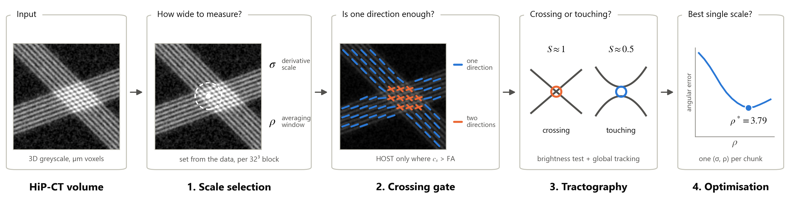
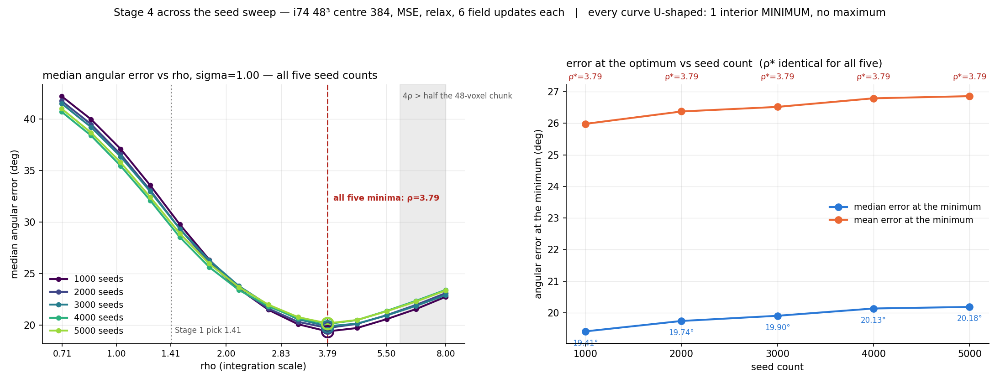

<div align="center">

<h1>Optimising the Structure Tensor Analysis of<br>White Matter Fibres in Synchrotron Tomography</h1>

Isabella Hezhao<sup>1</sup> · Andrew Keenlyside<sup>2</sup>

<sup>1</sup>Department of Medical Physics and Biomedical Engineering, University College London<br>
<sup>2</sup>UCL Hawkes Institute, University College London

[](https://github.com/1ssot0pe/HiP-CT_Structure_Tensor/actions/workflows/ci.yml)
[](LICENSE)
[](https://doi.org/10.5281/zenodo.24289711)

[Pipeline](docs/PIPELINE.md) | [Work log](docs/WORKLOG.md) | [Release](https://github.com/1ssot0pe/HiP-CT_Structure_Tensor/releases) | [Citation](#citation)

<picture>
  <source media="(prefers-color-scheme: dark)" srcset="docs/figures/pipeline_overview_dark.png">
  
</picture>

</div>

<sub><b>Figure 1.</b> Pipeline overview. Blue marks one fibre orientation
(plain structure tensor); orange marks two (HOST). Panels 1–2 show a 2D phantom with orientations from a plain
structure tensor. Panel 4 shows the measured curve from Figure 2. Drawn by
<a href="docs/figures/make_pipeline_overview.py"><code>make_pipeline_overview.py</code></a>.</sub>

## Overview

The structure tensor measures local fibre orientation in a 3D image. It has two
parameters: the derivative scale **σ** and the integration scale **ρ** (both in
voxels). They are usually set by hand. This code sets them from the data and
checks the result with tractography. It was written for Hierarchical
Phase-Contrast Tomography (HiP-CT) of human brain white matter.

| Stage | What it does | Code |
|---|---|---|
| 1.&nbsp;Scale&nbsp;selection | Chooses σ and ρ for each 32³ block (Lindeberg scale selection). | [`1_sigma_rho_selection/`](1_sigma_rho_selection/) |
| 2.&nbsp;Crossing&nbsp;gate | Finds voxels where one orientation is not enough and fits up to two there with the higher-order structure tensor ([HOST](2_host_classification/README.md#how-host-is-used-in-the-pipeline)). | [`2_host_classification/`](2_host_classification/) |
| 3.&nbsp;Tractography | Tracks fibres through the field, separates crossings from fibres that only touch, and refines the field. | [`3_global_tractography/`](3_global_tractography/) |
| 4.&nbsp;Optimisation | Finds the single (σ, ρ) whose plain structure tensor best matches the refined field. | [`4_optimising_parameters/`](4_optimising_parameters/) |

Two side studies support the pipeline.
[`mass_conservation/`](mass_conservation/) tells crossings from touching
fibres using image brightness alone. [`noise_model/`](noise_model/) measures
the imaging noise from half-reconstructions. [docs/PIPELINE.md](docs/PIPELINE.md) lists the inputs,
outputs and decisions of each stage.

<details>
<summary>Stage 2 variants</summary>

<br>

| Variant | Entry point | Decides | Gate | Use for |
|---|---|---|---|---|
| Standard | `3_global_tractography/run_pipeline.py` | per patch (stride-6 grid) | c<sub>s</sub> > FA | the validated end-to-end pipeline |
| Per-voxel, redesigned | `2_host_classification/run_dense_stage12.py` | every voxel, Gaussian window | λ<sub>3</sub>/λ<sub>2</sub> | the best per-voxel decision on real data |
| Per-voxel, patch-exact | `2_host_classification/export_nifti.py` | every voxel, box window | c<sub>s</sub> > FA | the standard result at full resolution, as MRtrix-style NIfTI |

The per-voxel variants need more compute. Andrew Keenlyside wrote the
patch-exact variant. See
[2_host_classification/README.md](2_host_classification/README.md#part-d--per-voxel-variants).

</details>

## Results

<p align="center">
  <picture>
    <source media="(prefers-color-scheme: dark)" srcset="docs/figures/stage4_rho_sweep_dark.png">
    
  </picture>
</p>

<sub><b>Figure 2.</b> Median angular error between the refined field and a
plain structure tensor, against ρ. i74 brain, one 48³-voxel chunk, 20 µm
voxels, σ = 1.00. Line: 5,000 seeds. Band: range over 1,000–5,000 seeds. Above
ρ ≈ 6 the Gaussian window (4ρ) is wider than half the chunk. Data:
<a href="results/seed_rho_curves.json"><code>results/seed_rho_curves.json</code></a>.
Script: <a href="docs/figures/make_stage4_rho_sweep.py"><code>make_stage4_rho_sweep.py</code></a>.</sub>

On this chunk the best match is at **σ = 1.00, ρ = 3.79**. The minimum is the
same for all five seed counts, and it does not move when the Stage 3 loss is
MAE instead of MSE (5,000 seeds). Stage 1 chose ρ = 1.41 on the same chunk.

This result has three limits:

- ρ is resolved only to the grid spacing (about 20%).
- On smaller 24³ chunks the minimum lies between ρ = 1.8 and 3.1, so the
  optimum depends on the region.
- The median angular error at the optimum is still about 20°.

Full results: [4_optimising_parameters/README.md](4_optimising_parameters/README.md).

## Setup

Requires Python 3.13. From the repository root:

```bash
python -m venv .venv
source .venv/bin/activate          # Windows: .venv\Scripts\activate
python -m pip install -r requirements.txt
```

`requirements-dev.txt` adds Jupyter, the Human Organ Atlas download tools and
the code formatters.

> [!NOTE]
> Create the environment outside synced folders (OneDrive, Dropbox). Syncing
> can corrupt the install.

## Usage

Checks with a known answer. They need no data, and CI runs them on every push.

```bash
python 3_global_tractography/test_frame_convention.py
python 3_global_tractography/run_pipeline.py --radius 16 --iters 1
```

Stages 1–3 on real data, then the Stage 3 optimisation loop and Stage 4:

```bash
python 3_global_tractography/run_pipeline.py --i74

python 3_global_tractography/descent_loop.py --radius 24 --seeds 5000 \
    --turn relax --refine-field --variant vec1 --outdir results/seed_5000
python 4_optimising_parameters/sigma_rho_match.py --run results/seed_5000
```

On Windows, `.\run_all.ps1` runs the checks and the real-data step in order and
stops at the first failure. `.\run_all.ps1 -Quick -SkipI74` is a one-minute
smoke test. The script expects a virtual environment at
`%USERPROFILE%\venvs\hipct-structure-tensor`; use `-Python` to give another.

Outputs go to `results/`. Git tracks only the small JSON summaries. The full
outputs of the recorded runs (tractograms, fields, HTML viewers) are attached
to the [release](https://github.com/1ssot0pe/HiP-CT_Structure_Tensor/releases).

## Data

The real-data steps use HiP-CT scans from the
[Human Organ Atlas](https://human-organ-atlas.esrf.fr/). This repository does
not redistribute them. All other steps run on synthetic phantoms with known
ground truth.

| Volume | Used by | Environment variable |
|---|---|---|
| i74 brain, sensitivity chunk (`*.tif` slices, 20 µm voxels) | Stages 1–4, `mass_conservation/` | `HIPCT_VOLUME_DIR` (default `data/i74/`) |
| LADAF-2022-13 left lung, two half-reconstructions (16.547 µm voxels) | `noise_model/` | `LUNG_HALF_A_DIR`, `LUNG_HALF_B_DIR` |

### Using any dataset

A volume is a folder of single-slice `*.tif` files. Two environment variables
select it:

| Variable | Meaning | Default |
|---|---|---|
| `HIPCT_VOLUME_DIR` | folder of `*.tif` slices | `data/i74` |
| `HIPCT_VOXEL_UM` | isotropic voxel size in µm (written to NIfTI and `.trk` headers) | `20` |

<details>
<summary>Examples and details</summary>

<br>

```powershell
# PowerShell (current terminal only)
$env:HIPCT_VOLUME_DIR = "data/lung_overview"
$env:HIPCT_VOXEL_UM   = "16.547"
python 3_global_tractography/run_pipeline.py --i74
```

```bash
# bash (current terminal only)
export HIPCT_VOLUME_DIR=data/lung_overview HIPCT_VOXEL_UM=16.547
python 3_global_tractography/run_pipeline.py --i74
```

- Relative paths resolve from the repository root. Absolute paths and `~` also
  work. `data/` is ignored by git.
- To set a variable permanently on Windows, run
  `setx HIPCT_VOLUME_DIR "D:\scans\brain_01"` once, then open a new terminal.
  VS Code needs a full restart.
- Real-data scripts analyse a cube cut from the volume (`--centre`,
  `--radius`; `load_volume` defaults to `crop=(200, 456)`). Make sure the cube
  fits inside your volume.
- `--i74` means "use real data". It reads whatever `HIPCT_VOLUME_DIR` points
  to.

</details>

## Repository structure

```
core/                      shared code: volume loading, structure tensor,
                           HOST-FOD, phantoms, noise library
1_sigma_rho_selection/     Stage 1
2_host_classification/     Stage 2
3_global_tractography/     Stage 3 (archive/ holds superseded experiments)
4_optimising_parameters/   Stage 4
mass_conservation/         side study: crossing test from brightness
noise_model/               side study: noise from half-reconstructions
notebooks/                 early structure tensor exploration
docs/                      pipeline description, work log, figures
results/                   JSON summaries of recorded runs
tools/                     repository checks used by CI
```

Each folder's README describes its scripts in order and what each experiment
found. Approaches that did not work are recorded in
[docs/archive/BAYES_TRACTOGRAPHY.md](docs/archive/BAYES_TRACTOGRAPHY.md).

## Limitations

- Stages 1–3 are validated on phantoms with known ground truth. Real data
  has no ground truth, so real-data results are measurements, not verified
  answers.
- The Stage 4 optimum is stable across seed counts and loss functions on one
  chunk, but differs between regions.
- The track-density target λ<sub>1</sub> − λ<sub>3</sub> cannot tell one bright
  fibre from two dim crossing fibres.
- Crossings of three or more fibres are labelled `complex` and not resolved.
- i74 has no half-reconstructions, so its noise model comes from lung data.
  Only the isotropic part of the noise spectrum is shown to transfer.

## Citation

If you use this code, please cite:

```bibtex
@software{hezhao2026structuretensor,
  author    = {Hezhao, Isabella and Keenlyside, Andrew},
  title     = {Optimising the Structure Tensor Analysis of White Matter
               Fibres in Synchrotron Tomography},
  year      = {2026},
  publisher = {Zenodo},
  doi       = {10.5281/zenodo.24289711},
  url       = {https://doi.org/10.5281/zenodo.24289711}
}
```

Hezhao, I. and Keenlyside, A. (2026). *Optimising the Structure Tensor Analysis
of White Matter Fibres in Synchrotron Tomography*. Zenodo.
https://doi.org/10.5281/zenodo.24289711

This DOI points to the latest release. Each release also has its own DOI
(v1.0.0: [10.5281/zenodo.24289712](https://doi.org/10.5281/zenodo.24289712)).
[CITATION.cff](CITATION.cff) provides other formats through GitHub's "Cite this
repository" button. If you use Human Organ Atlas data, also cite the datasets
as the Atlas asks.

## Acknowledgements

We thank Claire Walsh and Peter D. Lee (Department of Mechanical Engineering,
University College London) for their guidance and support. The HiP-CT data
were acquired at the European Synchrotron Radiation Facility (ESRF) by the
[Human Organ Atlas](https://human-organ-atlas.esrf.fr/) project.

## License

The code is released under the [MIT License](LICENSE). The license covers the
code only, not the HiP-CT data.
